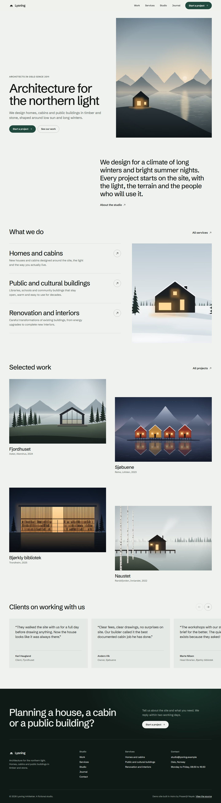
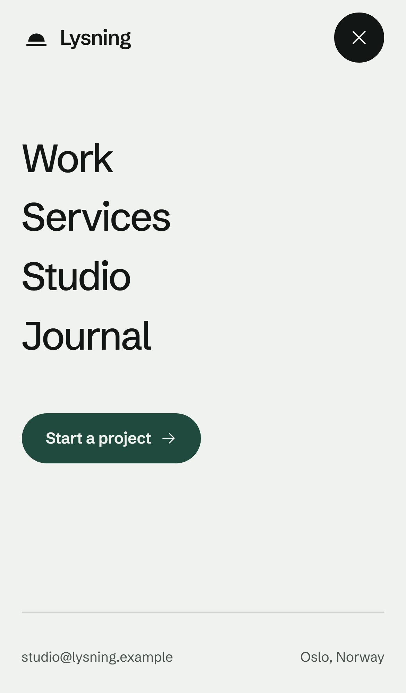
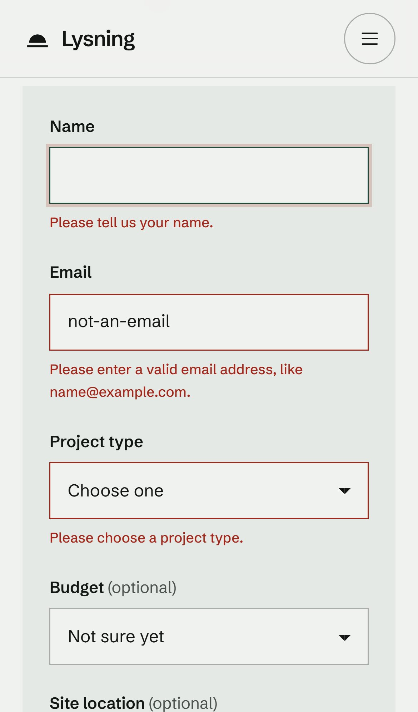
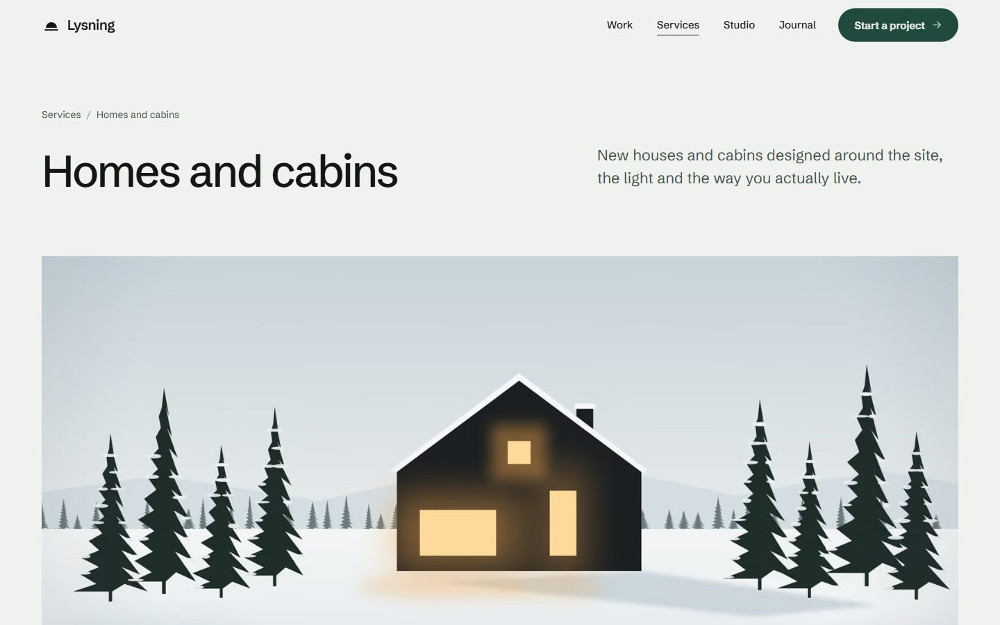
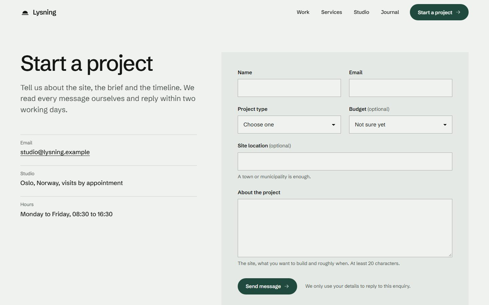

# Lysning Arkitekter: an Astro rebuild demo

An Astro demo built to show a Webflow-to-Astro style rebuild. It is a small marketing site for a fictional Oslo architecture studio, built the way an existing Webflow site would be rebuilt in Astro: same kind of pages, CMS-style content, interactions and contact form, but as typed components and content collections deployed to Cloudflare.

**Live:** https://astro-agency-rebuild.prasenjitt4e.workers.dev



## What it shows

- **Pages:** Home, Studio (about), Services (index and detail pages), Work (index and case study pages), Journal (blog) and Contact.
- **Content collections** for the journal, services and projects, with Zod schemas, images validated through `image()`, and a `reference()` from each project to its service, so a service page lists its own case studies.
- **Webflow-style interactions** in CSS and a few small scripts: scroll reveal, sticky header that blurs on scroll, full-screen mobile menu, hover image preview on the services list (CSS `:has()`, no JavaScript), testimonial slider with scroll snap, FAQ accordion on `<details>`, and cross-document view transitions. Everything respects `prefers-reduced-motion`.
- **A contact form** that posts to a server endpoint on Cloudflare Workers, validates on the client and the server, has a honeypot, and sends through Resend when an API key is configured.
- **Responsive images** generated at build time by `astro:assets` (AVIF and WebP with `srcset` and `sizes`) and a self-hosted variable font through the Astro Fonts API.
- **Cross-browser tests** with Playwright on Chromium, Firefox and WebKit, plus Android and iPhone emulation.

## Stack

| Area | Choice |
| --- | --- |
| Framework | Astro 7.3, TypeScript (strict) |
| Styling | Plain CSS: design tokens as custom properties, cascade layers, scoped component styles |
| Hosting | Cloudflare Workers with static assets (`@astrojs/cloudflare` 14), deployed with Wrangler |
| Email | Resend REST API through `fetch`, no SDK |
| Fonts | Schibsted Grotesk (a Norwegian grotesk, OFL) via the Astro Fonts API, preloaded with a size-adjusted fallback |
| Icons | Phosphor (MIT), inlined as Astro SVG components |
| Quality | `astro check`, Playwright on 5 browser projects, Lighthouse |

The only external JavaScript file is Astro's 2.5 KB prefetch helper. Component scripts are small inline modules. There is no UI framework and no CSS framework.

## Project structure

```text
src/
  assets/art/              Source images, generated by scripts/generate-art.mjs
  components/              Header, Footer, ServiceList, ProjectGrid, Testimonials, ContactForm, ...
  content/                 Markdown for journal posts, services and projects
  content.config.ts        Collection schemas
  data/site.ts             Site settings, navigation, testimonials, team
  icons/                   Phosphor SVGs
  layouts/BaseLayout.astro Meta tags, Open Graph, JSON-LD, font loading
  lib/                     Form limits and options, Resend helper, formatting
  pages/                   Routes, including pages/api/contact.ts
  scripts/                 Client scripts: reveal, header and menu, carousel, form
  styles/global.css        Tokens, reset, typography and shared components
scripts/
  generate-art.mjs         Draws every illustration as SVG and rasterises it with sharp
  screenshots.mjs          Documentation screenshots
tests/site.spec.ts         Playwright tests
docs/                      Screenshots and Lighthouse reports
```

## How the contact form works

1. The form is plain HTML (`method="post" action="/api/contact"`) with native constraints: `required`, `type="email"`, `minlength`, `maxlength`. Without JavaScript it still works: the endpoint answers with a 303 redirect to `/contact/thanks`, or back to the form, where a `:target` message explains the error.
2. With JavaScript, `src/scripts/contact-form.ts` takes over. It shows inline errors after interaction, keeps `aria-invalid` in sync, moves focus to the first invalid field, posts with `fetch`, and swaps the form for a success panel.
3. `src/pages/api/contact.ts` is the only on-demand route (`export const prerender = false`). Every page is prerendered HTML. The endpoint:
   - rejects bodies over 16 KB,
   - accepts and silently drops submissions that fill the hidden honeypot field (`website`),
   - validates with Zod from `astro/zod`, using the same limits and options as the HTML (`src/lib/contact.ts`), and returns field-level errors,
   - with `RESEND_API_KEY` set, sends the enquiry through the Resend API with `reply_to` set to the visitor and an idempotency key so a retry does not send a duplicate,
   - without a key, runs in demo mode: it returns success and logs a structured JSON event with a masked email address instead of sending.
4. Astro's built-in origin check (`security.checkOrigin`) blocks cross-site form posts.
5. Secrets are read through `astro:env` (`RESEND_API_KEY`, `CONTACT_TO_EMAIL`, `CONTACT_FROM_EMAIL`), so the same endpoint runs on the Node adapter, for example on Railway, without code changes.

The deployed demo has no Resend key on purpose, so it runs in demo mode. To turn sending on:

```sh
npx wrangler secret put RESEND_API_KEY
npx wrangler secret put CONTACT_TO_EMAIL
npx wrangler secret put CONTACT_FROM_EMAIL   # an address on a domain verified in Resend
```

For local testing, copy `.dev.vars.example` to `.dev.vars` before `npm run build`; the Cloudflare Vite plugin copies it into the build that `astro preview` runs. The send path was checked locally with an invalid key: Resend answered 401, the endpoint returned a friendly 502 and logged `contact.send_failed`.

## Performance

Lighthouse 13.5 against the deployed site on October 5, 2026, default settings (mobile is simulated slow 4G with a 4x CPU slowdown):

| Page | Device | Performance | Accessibility | Best practices | SEO |
| --- | --- | --- | --- | --- | --- |
| `/` | Mobile | 100 | 100 | 100 | 100 |
| `/` | Desktop | 100 | 100 | 100 | 100 |
| `/about` | Mobile | 100 | 100 | 100 | 100 |
| `/services` | Mobile | 99 | 100 | 100 | 100 |
| `/services/homes-and-cabins` | Mobile | 99 | 100 | 100 | 100 |
| `/work` | Mobile | 99 | 100 | 100 | 100 |
| `/work/fjordhuset` | Mobile | 100 | 100 | 100 | 100 |
| `/journal` | Mobile | 100 | 100 | 100 | 100 |
| `/journal/designing-for-the-low-winter-sun` | Mobile | 99 | 100 | 100 | 100 |
| `/contact` | Mobile | 100 | 100 | 100 | 100 |

Home page on mobile: First Contentful Paint 0.9 s, Largest Contentful Paint 1.1 s, Total Blocking Time 0 ms, Cumulative Layout Shift 0. The 99s come from Speed Index varying between runs; `/services` and `/work` scored 100 in the run before. Full reports for the home page are in [`docs/lighthouse`](docs/lighthouse), and every run is in [`docs/lighthouse/scores.json`](docs/lighthouse/scores.json).

What keeps it fast: prerendered HTML served from Cloudflare's edge, CSS inlined into each page so nothing blocks rendering, one preloaded 46 KB variable font file with a metric-matched fallback, AVIF and WebP images sized through `srcset`, explicit dimensions on every image, and `fetchpriority="high"` only on the image that is the Largest Contentful Paint.

Accessibility: landmarks and a skip link, sequential headings, visible focus styles, labelled fields with described-by hints and errors, `aria-current` in the navigation, a mobile menu built on `<dialog>` (focus stays inside, Escape closes it), a keyboard-scrollable carousel, and alt text on every meaningful image.

## Cross-browser testing

`tests/site.spec.ts` has 22 checks that run on 5 Playwright projects: Chromium, Firefox and WebKit on desktop, plus Pixel 7 and iPhone 14 emulation. They cover every page rendering one `h1` with no console errors, a real 404 status, desktop navigation and `aria-current`, the mobile menu dialog, scroll reveal, collection links between services and projects, markdown rendering, and the form and API: inline validation, a successful submission, field errors from the server, the honeypot, the no-JavaScript redirect, the cross-site block and `405` for `GET`.

```sh
npx playwright install chromium firefox webkit
npm run build && npm test
BASE_URL=https://astro-agency-rebuild.prasenjitt4e.workers.dev npx playwright test
```

Last run: 105 passed and 5 skipped (the skips are the desktop-only and mobile-only navigation checks), both against `astro preview` and against production.

## Screenshots

| Mobile | Mobile menu | Form validation |
| --- | --- | --- |
|  |  |  |





## Running locally

Requires Node 22.12 or newer.

```sh
npm install
npm run dev        # http://localhost:4321, runs in workerd through the Cloudflare Vite plugin
npm run check      # astro check
npm run build      # prerendered pages plus the Worker for /api/contact
npm run preview    # serve the build in workerd
npm run deploy     # build, then wrangler deploy
npm run art        # regenerate the images in src/assets/art
```

## Images

There are no stock photos. `scripts/generate-art.mjs` draws each illustration as SVG (mountain ridges from layered noise, timber cladding, a contour map traced from a height field with marching squares), rasterises it with sharp and adds a light grain so gradients do not band. `astro:assets` then turns those source JPEGs into AVIF and WebP variants at build time.

## How this maps to a Webflow rebuild

- **Style guide and classes:** design tokens in `src/styles/global.css` (colours, a fluid type scale, spacing) plus scoped styles per component, so spacing and type can be matched to the original design value by value.
- **Symbols and components:** Astro components with typed props.
- **CMS collections and template pages:** content collections with schemas, and `getStaticPaths` for `/services/[slug]`, `/work/[slug]` and `/journal/[slug]`. A Webflow CMS CSV export can be converted to Markdown or loaded with a custom loader.
- **Interactions:** CSS transitions, `:has()` and IntersectionObserver instead of Webflow Interactions, with reduced-motion fallbacks.
- **Forms:** an Astro endpoint and Resend instead of Webflow form handling, so submissions go straight to the client's inbox.
- **Hosting:** Cloudflare Workers static assets. Pages are served from the edge and the Worker only runs for the form endpoint.

## Notes

- Lysning Arkitekter is fictional. The names, projects, quotes and numbers are invented for the demo, and the email address uses the reserved `.example` domain.
- Built with AI assistance (Cursor with Claude) and reviewed by me, Prasenjit Nayak.
